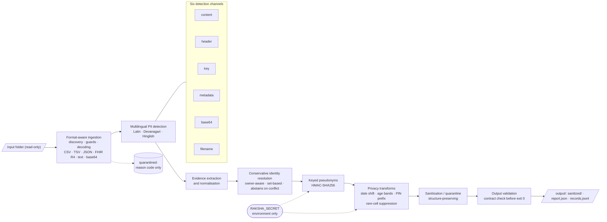

# CLINVEIL

**An offline, multilingual privacy firewall for Indian clinical records.**

CLINVEIL de-identifies messy hospital exports (English, Hindi in Devanagari, and Hinglish) on a CPU, with no
network. It removes personal data wherever it hides, keeps clinical values exactly intact, gives each patient one
stable keyed pseudonym when the evidence is strong enough, and generalises or suppresses the indirect identifiers
that make re-identification possible.

Team **APEX** · Yugaantar DevForge · **Track 3: Secret Wards** ·
Repository: <https://github.com/Amartya989870xxxx/CLINVEIL> ·
Project Brief: [docs/brief/CLINVEIL_Project_Brief.pdf](docs/brief/CLINVEIL_Project_Brief.pdf)

All data handled in development and demonstration is **synthetic**. No real patient data is used or permitted.

---

## Overview

Hospital data is spread across systems, file formats and scripts. The same patient appears as a CSV row, a FHIR
Bundle and a Hinglish nursing note, sometimes under different record numbers. Removing names is not enough:
an exact age, a village, a visit date, a length of stay or a rare diagnosis can identify a person when combined
with a public register.

CLINVEIL is built around three rules:

1. **Find personal data in every channel:** content, CSV/TSV headers, JSON keys, export metadata, base64
   payloads and file names, in Latin script, Devanagari and Hinglish.
2. **Link patients conservatively.** Every identifier has an *owner*: a father's Aadhaar in a child's note is
   evidence about a relative. It can veto a link, never create one. Conflicting groups abstain. A wrong merge
   costs more than a missed one.
3. **Keep clinical meaning.** Medicines, doses, vitals, lab values, diagnoses and file structure are preserved.
   Dates are shifted per patient, so intervals stay exact.

## Key capabilities

| Capability | Status |
|---|---|
| Multilingual PII detection (English, Hindi/Devanagari, Hinglish): names, relatives, Aadhaar, ABHA, PAN, MRN/UHID, phone, e-mail, insurance IDs, house/locality/landmark/village, PIN, DOB | Implemented |
| Six detection channels: content, header, key, metadata, base64, filename | Implemented |
| Conservative identity resolution: typed, owner-aware evidence, strict cross-script name keys, set-based complete-linkage clustering, abstention on conflict, distinct-UHID veto | Implemented |
| Keyed pseudonyms: domain-separated HMAC-SHA256 over `RAKSHA_SECRET`, no stored mapping | Implemented |
| Per-patient date shift: one keyed offset per linked patient (±180 days, never 0); unlinked records get their own offset | Implemented for structured date fields, date-named JSON keys and full dates in free text. Not for base64 payloads or export audit timestamps |
| Ambiguous dates: day/month order inferred per document; dates whose order cannot be established are suppressed as `[DATE]` | Implemented |
| 5-year age bands (`47` → `45-49`, `73/F` → `70-74/F`) | **Partial:** structured age fields only. JSON numeric ages and ages inside free text are kept as written |
| DOB | Removed (`[DOB]`); FHIR `birthDate` keeps the year |
| PIN → 3-digit prefix (`226XXX`) with rare-cell suppression | **Partial:** a prefix is kept only if at least `min_group_size` (5) records in the same file share (age band, gender, prefix); otherwise `[PIN]`. Not formal k-anonymity |
| Village → tehsil/district | **Not implemented:** no trusted offline mapping exists, so villages are suppressed (`[VILLAGE]`) |
| Quarantine of unsafe or unsupported files (never copied raw) | Implemented |
| Web interface with upload to a local engine | Implemented (optional, local only; see [Frontend](#frontend-optional)) |

## Architecture



| Stage | Module | What it does |
|---|---|---|
| Ingestion | `clinveil.ingestion` | deterministic discovery; symlink, size and special-file guards; content-based format detection; UTF-8/BOM/UTF-16/cp1252 decoding |
| Parsing | `clinveil.parsing` | one intermediate representation (`Document`/`Field` with address, record and channel); bounded JSON; FHIR roles and references; base64 payloads |
| Detection | `clinveil.detection` | column semantics (renamed and Hindi labels), validated identifiers, contextual names and relatives, address components, clinical and doctor protection, run-wide value propagation |
| Linking | `clinveil.linking` | owner-aware typed evidence, blocking, complete-linkage clustering, ambiguous-bridge freezing |
| Privacy | `clinveil.privacy` | HMAC pseudonyms and date-shift keys (`pseudonym.py`), date/age/PIN transforms (`transform.py`) |
| Sanitisation | `clinveil.sanitization` | applies findings and Phase 4 transforms per format; FHIR references rewritten consistently |
| Export / validation | `clinveil.export`, `clinveil.validation` | `report.json`, `records.jsonl`, in-process contract check |

More detail: [docs/architecture/SYSTEM_ARCHITECTURE.md](docs/architecture/SYSTEM_ARCHITECTURE.md).

## Supported formats

| Input | Handling |
|---|---|
| CSV, TSV (UTF-8, UTF-8 with BOM, UTF-16 with or without BOM, cp1252) | parsed; headers are a detection channel |
| JSON (nested; bounded depth, size and node count from `config/policy.yaml`) | parsed; keys are a detection channel |
| FHIR R4 JSON Bundles | parsed per resource; references rewritten consistently; `birthDate` → year |
| Plain text (notes, prescriptions, chat exports) | parsed as free text |
| XHTML narratives inside FHIR resources (`text.div`) | parsed with tag-aware ownership |
| Base64 text payloads inside JSON/FHIR or text | decoded, sanitised, re-encoded |
| Binary attachments inside JSON/FHIR (scans, photos, PDFs) | withheld (the `data` member is removed) |
| Whole XML or HTML files, PDF, image, archive, other binary or empty files | **quarantined** (listed in `report.json` with a reason code, never copied) |

Detection is content-based, not extension-based.

## Technology stack

- **Engine:** Python ≥ 3.10, **standard library only** (`requirements.txt` has no packages). No models, no
  LLM, no network at runtime.
- **Tests and linting:** pytest, Ruff (`backend[dev]` extras).
- **Frontend (optional):** React 18, TypeScript, Vite, Vitest. Fonts are bundled (see
  [frontend/THIRD_PARTY_FONTS.md](frontend/THIRD_PARTY_FONTS.md)).
- **Local demo API (optional):** `backend/scripts/demo_api.py`, standard library only. It runs the same CLI
  engine in a subprocess.

## Installation

```bash
git clone https://github.com/Amartya989870xxxx/CLINVEIL.git && cd CLINVEIL
pip install -r requirements.txt                 # evaluator setup step (no packages: a no-op)

# development (tests and lint)
python3 -m venv .venv
.venv/bin/pip install -e "backend[dev]"         # pytest + ruff
```

The organiser toolkit (validators and practice data) is not part of this repository. Place it at
`./organiser-toolkit` (git-ignored, never modified) to run the official checks.

## Configuration and secrets

| Variable | Required | Purpose |
|---|---|---|
| `RAKSHA_SECRET` | **yes** | per-release key for pseudonyms and date shifts. Without it the run fails closed (exit 2). Never commit, print or store it |
| `CLINVEIL_POLICY` | no | alternative policy file (or `--policy <file>`); default `config/policy.yaml` |
| `CLINVEIL_TOOLKIT` | dev only | organiser toolkit location for tests and `official_checks.sh` |

There is no default secret anywhere in the code. Generate a fresh random value per release, for example
`export RAKSHA_SECRET="$(python3 -c 'import secrets; print(secrets.token_hex(32))')"`. The same secret gives the
same pseudonyms and date shifts; a different secret gives unlinkable ones.

`config/policy.yaml` (flat `key: value`, read without PyYAML):

| Key | Value | Meaning |
|---|---|---|
| `age_band_years` | 5 | width of age bands (a band always contains the true age) |
| `date_shift_max_days` | 180 | per-patient date offsets lie in ±180 days, never 0 |
| `min_group_size` | 5 | rare-cell threshold for keeping a PIN prefix |
| `max_file_bytes`, `max_json_bytes`, `max_json_depth`, `max_json_nodes`, `max_attachment_bytes` | see file | ingestion safety limits; larger inputs are quarantined |

## Running CLINVEIL

```bash
export RAKSHA_SECRET="$(python3 -c 'import secrets; print(secrets.token_hex(32))')"
python main.py --input <input dir> --output <empty output dir>
```

This is the command in `raksha.toml`. Exit codes: `0` complete release, `1` incomplete release or fatal error,
`2` usage error (missing secret, overlapping directories). stdout and stderr carry counts only.

## Output

```text
output/
├── sanitized/      sanitised copies of every processed file, in the original format and structure
│                   (PII-bearing file names are renamed; quarantined files are absent)
├── report.json     counts (files, records, identifiers, linked/generalised/suppressed records), applied
│                   redactions by entity type, every input file's SHA-256, output path, status and reason
│                   code, timing and peak memory.
│                   No personal data, no key material
└── records.jsonl   one line per record: {"file", "loc", "patient"}; "patient" is the keyed pseudonym
                    (PSN-XXXXXX) of a linked record, or null. No plaintext identity mapping
```

A `logs/` folder holds PII-free detection counts.

## Testing and results

```bash
cd backend
../.venv/bin/python -m pytest -q                       # unit, integration, regression, security
../.venv/bin/ruff check src tests scripts ../main.py
../.venv/bin/ruff format --check src tests scripts ../main.py
cd ..
backend/scripts/official_checks.sh                     # run + validate_output.py + check_dev.py
backend/scripts/official_checks.sh --submit            # + check_submission.py --run
cd frontend && npm ci && npm test && npm run build     # optional frontend
```

Results below are **development measurements on the organiser's public practice dataset** (engine at commit
`442dfbd`, unchanged since), not official competition scores. The hidden evaluation data has not been seen.

| Measure (practice data unless stated) | Result |
|---|---|
| Automated tests | 1,146 backend tests pass on Python 3.10.20, 3.12.13 and 3.13.7; 86 frontend tests (Vitest); Ruff check and format clean (108 files) |
| Official `validate_output.py` / `check_submission.py --run` | CONTRACT OK / READY TO SUBMIT |
| Files | 200 processed: 193 sanitised, 7 quarantined, 822 records |
| Identity linkage (pairwise, check_dev formula) | TP 6,706 · FP 0 · FN 186 → precision 1.00, recall 0.973 |
| FHIR | 19 Bundles, 459 references, 0 unresolved after sanitisation |
| Determinism / unlinkability | same secret: identical outputs (except timing fields); different secret: 0 of 53 pseudonyms shared, same patient grouping |
| Known-value scans | 0 of 22 PINs, 0 of 78 DOBs, 0 of 47 villages from the practice key visible in output content or file names |
| Run time / peak memory | 2.42 s engine time and 41.2 MiB peak RSS (from `report.json`); 2.56 s wall clock. Apple M4 Pro, single process. **The 2-CPU / 4 GB sandbox limits were not enforced** in this measurement |

## Frontend (optional)

A local web interface in `frontend/` explains the system, lets you upload synthetic files, runs the **real
engine** through the local demo API, shows live results and offers the engine's own outputs for download. It is
never on the evaluator path. Requires Node 20+.

```bash
.venv/bin/python backend/scripts/demo_api.py          # terminal 1: http://127.0.0.1:8765/api/v1
cd frontend && npm ci && npm run dev                  # terminal 2: http://127.0.0.1:5173
```

Choose **Local backend** in the interface to process files. **Example mode** shows a clearly labelled recorded
run and never processes anything. The demo API:

- binds to 127.0.0.1 only and rejects non-local Host/Origin headers;
- uses a random per-process secret that is never served;
- accepts uploads of `.csv .tsv .tab .txt .json` only, with plain base names, up to 200 files and 32 MB;
- runs one job at a time;
- deletes uploads and runs when they are evicted or the server stops.

Contract: [docs/api-contract/frontend-v1.md](docs/api-contract/frontend-v1.md). Details:
[frontend/README.md](frontend/README.md). There is no production deployment.

## Privacy, security and limitations

**Security design.** Every input is untrusted:
- A symlink that leaves the input root is never opened. Broken symlinks, FIFOs/devices and oversized files are
  quarantined unparsed.
- Reads use the verified real path (`O_NOFOLLOW`, regular files only).
- A failure quarantines only that file, with a fixed reason code. Exception messages are never recorded, because
  they can echo PII.
- The secret is wrapped in a type that refuses to print or pickle.
- Nothing is logged except counts, and no intermediate files are written.
- The process refuses an output directory that overlaps its input.

There is no encryption at rest. Full model: [docs/security/THREAT_MODEL.md](docs/security/THREAT_MODEL.md).

**Known limitations.** CLINVEIL reduces disclosure risk. It does not guarantee anonymity or remove all
re-identification risk.

- **OBS-1:** when a narrative gives a relative's name in one block and their age or Aadhaar in a later block, those
  values can fall outside the ownership window and be attributed to the patient, which can cause a false merge.
- **OBS-2:** a Devanagari danda (`।`) next to a gender word can reduce free-text gender recall.
- **Age generalisation is partial:** JSON numeric ages and ages inside free text are not banded.
- **Villages are suppressed, not generalised:** there is no village → tehsil/district mapping. Tehsil, district and
  state fields are kept.
- **Rare-cell protection is limited:** it covers the PIN prefix only, per file. Other quasi-identifiers (age band,
  gender, district, diagnosis, visit week) are not suppressed, and there is no formal k-anonymity.
- **Date-shift gaps:** dates inside base64 payloads and export audit timestamps (`lastUpdated`, `generated_at`) are not
  shifted.
- **Conservative linking:** some records of the same patient stay unlinked (recall 0.973 on practice data). Unlinked
  records of one patient get different date offsets.
- **Detection gaps:** names with no context cue that never appear in a structured field can be missed. Hex encodings
  inside plain text are not decoded.
- **Unsupported whole files:** XML, PDF and image files are quarantined, so their content is absent from the release.
- **No external audit of Phase 4:** the privacy transforms have not been independently audited. The Phase 3 linking
  layer passed targeted independent audits of specific findings only.

Phase history and audit trail: [docs/PROJECT_HANDOFF.md](docs/PROJECT_HANDOFF.md),
[docs/evaluation/](docs/evaluation/).

## Project Brief

The 2-page brief for the organisers: [docs/brief/CLINVEIL_Project_Brief.pdf](docs/brief/CLINVEIL_Project_Brief.pdf)
(source: [docs/brief/project_brief.html](docs/brief/project_brief.html)).

## Repository structure

```text
raksha.toml  main.py  requirements.txt  config/policy.yaml   evaluator contract (repository root)
backend/
  src/clinveil/        engine: ingestion, parsing, detection, linking, privacy, sanitization, export, validation
  tests/               unit, integration, regression (per phase and audit), security, generalization
  scripts/             official_checks.sh, dev_eval.py, demo_api.py (optional local API)
frontend/              optional React interface (never on the evaluator path)
docs/                  architecture/ decisions/ security/ evaluation/ api-contract/ frontend/ brief/ team/
organiser-toolkit/     official kit, git-ignored, never modified
```

## Team

CLINVEIL is built by team **APEX** for Yugaantar DevForge, Track 3: Secret Wards. Third-party portions and their
licences are listed below.

## Copyright and licensing

CLINVEIL is a product of team **APEX** (the team name registered for Secret Wards).

**No open-source licence is granted for CLINVEIL.** Original CLINVEIL material is
Copyright © 2026 its respective contributors, all rights reserved. Making this repository
public (as the hackathon requires) lets people view it. It does **not** grant permission to use,
copy, modify, redistribute, sublicense or commercialise it, except where applicable law or
GitHub's Terms of Service (which let users view and fork public repositories on GitHub) already
allow it. Evaluation by the event organisers is covered by the hackathon's submission terms.

**Third-party portions keep their own licences.** Parts of the backend are adapted from the
organisers' Secret Wards starter (MIT, Copyright (c) 2026 kartikeyajay2006). The files concerned, the
extent of reuse and the full MIT text are in [THIRD_PARTY_NOTICES.md](THIRD_PARTY_NOTICES.md) and
[third_party_licenses/](third_party_licenses/). That MIT licence applies to those portions only.

**Contributor IP:** no contributor licence or IP-assignment agreements exist yet. Contributors
retain whatever rights they hold in their own contributions. Ownership and assignment must be settled
in writing before CLINVEIL is commercialised (see [CONTRIBUTING.md](CONTRIBUTING.md#contributions-and-intellectual-property)).

**History note:** commit `59c0ea8` (the first published commit) contained an MIT `LICENSE` file. It
was removed in a later commit, and the published history was deliberately not rewritten.
